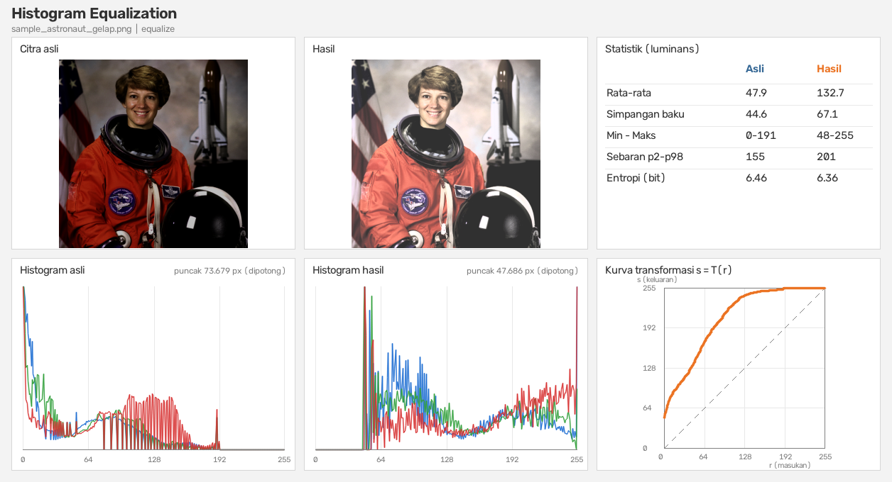
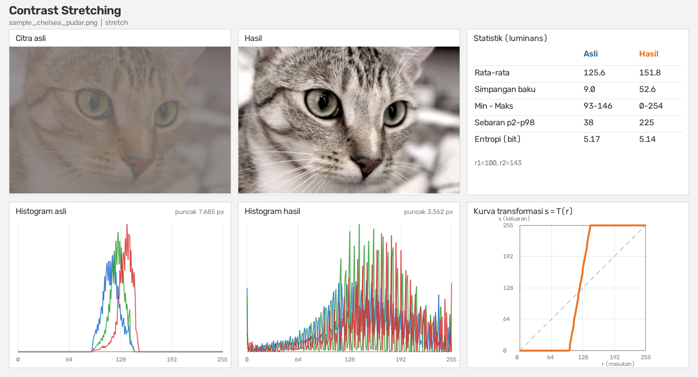
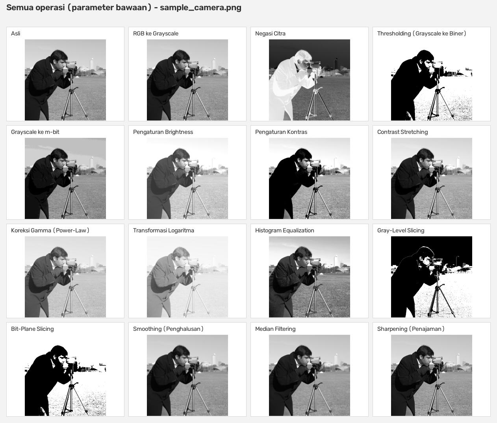
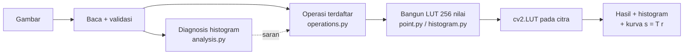
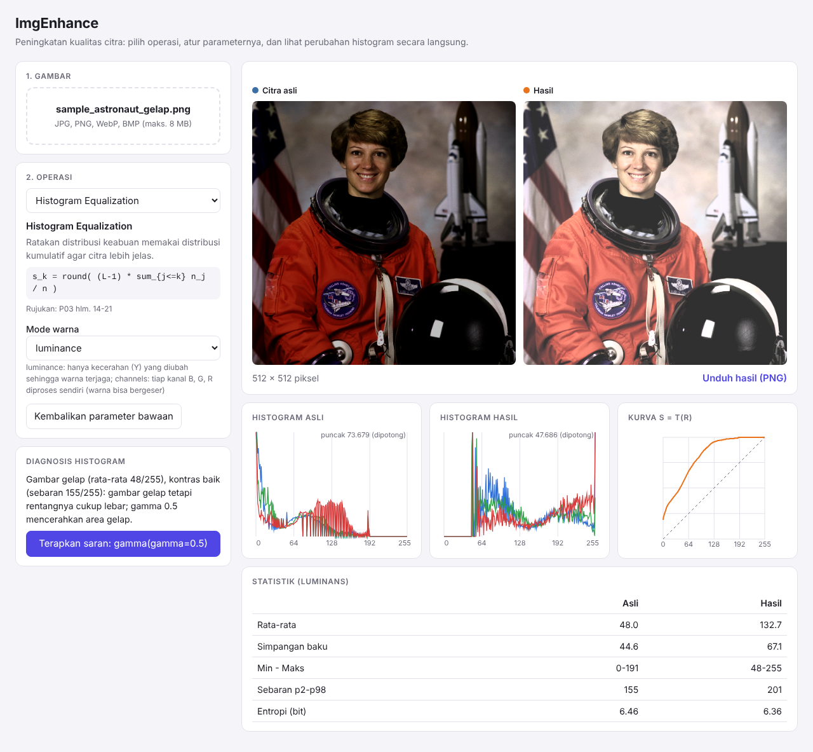

# ImgEnhance - Peningkatan Kualitas Citra dengan Python

Aplikasi Python untuk **meningkatkan kualitas citra** (*image enhancement*): mengatur kecerahan dan
kontras, koreksi gamma, *contrast stretching*, **histogram equalization**, thresholding, dan operasi
titik lain dari materi P03. Setiap hasil disertai histogram sebelum / sesudah dan kurva transformasi
`s = T(r)` sehingga **efek sebuah operasi bisa dibaca langsung dari grafiknya**.

Dibuat sebagai paket Python yang siap dipakai: library, CLI, webcam, demo web, uji otomatis, dan CI.

| | |
|---|---|
| Tugas | Latihan Image Enhancement |
| Mata kuliah | Pengolahan Citra, Teknik Informatika (Semester 5), UBSI |
| Nama | Muhamad Arya Satya Athaillah |
| NIM | `15240231` |
| Kelas | 15.5B.25 |
| Materi | P03 - Peningkatan Kualitas Citra (*Image Enhancement*) |

## Hasil

**Histogram equalization** pada foto yang terlalu gelap. Histogram asli menumpuk di sisi kiri; setelah
equalization tersebar lebih merata (rata-rata keabuan 47,9 menjadi 132,7). Kurva di kanan bawah adalah
fungsi transformasinya.



**Contrast stretching** pada foto yang pudar (rentang keabuan hanya 93-146):



`imgenhance all` menerapkan seluruh operasi sekaligus (parameter bawaan) dalam satu lembar kontak:



> Gambar contoh di `examples/images/` berasal dari dataset `scikit-image` yang sengaja digelapkan /
> dipudarkan / dicerahkan untuk demo (lihat [examples/images/README.md](examples/images/README.md)).
> Uji juga dengan foto sendiri.

## Fitur

- **15 operasi** sesuai materi P03: RGB ke grayscale, negasi, thresholding (+ Otsu), grayscale ke m-bit,
  brightness, kontras, contrast stretching, gamma, logaritma, histogram equalization, gray-level
  slicing, bit-plane slicing. Ditambah **smoothing, median, dan sharpening** sebagai pelengkap.
- **Berbasis look-up table (LUT)** - tiap operasi titik dihitung sebagai tabel 256 nilai lalu dipakai
  lewat `cv2.LUT`; tabel yang sama dipakai untuk menggambar kurva `s = T(r)`.
- **Gambar berwarna aman** - equalization dan stretching bekerja pada kanal kecerahan (Y) sehingga
  warna tidak bergeser (`--color-mode channels` bila ingin per kanal B, G, R).
- **Diagnosis histogram** - `analyze` membaca apakah gambar gelap / terang / kontras rendah, dan `auto`
  langsung menerapkan perbaikan yang cocok.
- **Pipeline** - rangkai beberapa operasi: `grayscale gamma:gamma=0.6 equalize`.
- **Lima cara pakai** - CLI satu gambar, CLI banyak gambar (+ CSV), webcam real-time, demo web, dan
  library Python.
- **Keluaran JSON** (`--json`), kode keluar yang jelas, dan validasi parameter dengan pesan galat Indonesia.
- **Library bertipe penuh** (`py.typed`) dengan hierarki exception yang jelas.

## Cara kerja



Rumus tiap operasi (semuanya memakai `r` = intensitas masuk, `s` = intensitas keluar):

| Operasi | Rumus | Rujukan |
|---|---|---|
| Negasi | `s = 255 - r` | hlm. 22 |
| Brightness | `s = r + t` | hlm. 13 |
| Kontras | `s = G (r - P) + P` | hlm. 25 |
| Gamma | `s = 255 (r / 255)^gamma` | hlm. 9 |
| Logaritma | `s = c log(1 + r)`, `c = 255 / log 256` | hlm. 9 |
| Thresholding | `s = 255` bila `r >= T`, selain itu `0` | hlm. 27-29 |
| m-bit | `s = langkah * floor(r / langkah)`, `langkah = 256 / 2^m` | hlm. 12 |
| Equalization | `s_k = round((L-1) * sum_{j<=k} n_j / n)` | hlm. 14-21 |

Penjelasan lengkap dan pembahasan contoh soal materi ada di [docs/teori.md](docs/teori.md); rincian
desain kode di [docs/architecture.md](docs/architecture.md).

## Instalasi

Butuh **Python 3.9+**.

```bash
# (disarankan) virtual environment
python -m venv .venv
.venv\Scripts\activate            # Windows
source .venv/bin/activate         # macOS / Linux

pip install -e .                  # CLI + library
pip install -e ".[web]"           # + demo web
pip install -e ".[dev]"           # + alat pengembangan (pytest, ruff, mypy, ...)
```

Perintah `imgenhance` tersedia setelah instalasi. Alternatif tanpa instalasi paket:
`python -m imgenhance ...` dengan `PYTHONPATH=src` (di Windows PowerShell: `$env:PYTHONPATH="src"`).

## Penggunaan

### Daftar operasi

```bash
imgenhance list                   # semua operasi, rumus, parameter, dan nilai bawaannya
imgenhance apply stretch --help   # opsi satu operasi
```

### Satu gambar

```bash
imgenhance apply equalize examples/images/sample_astronaut_gelap.png
imgenhance apply gamma examples/images/sample_coffee_terang.png --gamma 2.0
imgenhance apply stretch examples/images/sample_chelsea_pudar.png --mode percentile --percent 1
```

Hasil dicetak ke terminal, gambar hasil disimpan ke `output/<nama>_<operasi>.png`, gambar perbandingan
ke `output/<nama>_<operasi>_compare.png`, dan jendela hasil dibuka bila ada layar.

```
=== sample_astronaut_gelap.png ===
Operasi : equalize
                        Asli     Hasil
  Rata-rata             47.9     132.7
  Simpangan baku        44.6      67.1
  Min - Maks           0-191    48-255
  Sebaran p2-p98         155       201
  Entropi (bit)         6.46      6.36
```

Opsi yang umum dipakai:

| Opsi | Fungsi |
|---|---|
| `--json` | Cetak hasil sebagai JSON (stdout), log tetap di stderr |
| `--no-compare` | Jangan buat gambar perbandingan |
| `--max-side PX` | Perkecil gambar sebelum diproses (default: ukuran asli) |
| `-o DIR` | Folder hasil (default `output`) |
| `--show` / `--no-show` | Buka / jangan buka jendela hasil (default: otomatis bila ada layar) |
| `-v` / `-q` | Log debug / hanya peringatan dan galat |

### Baca histogram, lalu perbaiki otomatis

```bash
imgenhance analyze examples/images/sample_astronaut_gelap.png
imgenhance auto examples/images/sample_chelsea_pudar.png
```

```
Rata-rata keabuan : 47.9 / 255
Simpangan baku    : 44.6
Min - Maks        : 0 - 191
Sebaran p2-p98    : 155
Entropi           : 6.46 bit
Kecerahan         : gelap
Kontras           : baik
Diagnosis         : Gambar gelap (rata-rata 48/255), kontras baik (sebaran 155/255): gambar gelap tetapi rentangnya cukup lebar; gamma 0.5 mencerahkan area gelap.
Saran             : imgenhance auto <gambar>   (= gamma(gamma=0.5))
```

Aturannya: gelap / terang **dan** kontras rendah dipilihkan `equalize`; gelap atau terang saja dipilihkan
`gamma`; kecerahan wajar tetapi kontras rendah dipilihkan `stretch`.

### Rangkaian operasi (pipeline)

```bash
imgenhance pipeline foto.jpg grayscale gamma:gamma=0.6 equalize
```

Satu langkah ditulis `nama` atau `nama:kunci=nilai,kunci=nilai`. Semua langkah divalidasi sebelum
diproses sehingga salah ketik langsung ketahuan.

### Semua operasi sekaligus

```bash
imgenhance all examples/images/sample_camera.png      # lembar kontak *_semua.png
```

### Banyak gambar

```bash
imgenhance batch examples/images --auto               # pilih perbaikan per gambar
imgenhance batch foto/ -r equalize gamma:gamma=0.7    # semua sub-folder, langkah yang sama
```

Menghasilkan gambar hasil dan `output/summary.csv` (rata-rata, simpangan baku, sebaran, dan entropi
sebelum / sesudah; UTF-8 BOM supaya Excel membukanya dengan benar). File yang rusak dilewati dengan
peringatan; kode keluar `1` bila ada yang gagal.

### Webcam

```bash
imgenhance webcam equalize
```

| Tombol | Fungsi |
|---|---|
| `n` / `p` | Operasi berikutnya / sebelumnya |
| `+` / `-` | Ubah parameter utama operasi |
| `r` | Kembalikan parameter bawaan |
| `h` | Tampilkan / sembunyikan histogram |
| `c` | Bandingkan asli / hasil |
| `s` | Simpan snapshot ke `output/` |
| `q` / `ESC` | Keluar |

### Demo web

```bash
pip install -e ".[web]"
imgenhance serve                  # http://127.0.0.1:8000
```

Unggah foto lewat browser, pilih operasi, geser parameter, lalu lihat histogram dan kurva berubah
langsung. API: `GET /api/operations`, `POST /api/enhance`, dokumentasi interaktif di `/api/docs`.



Kode keluar CLI: `0` sukses, `1` galat operasional (file tidak ada, gambar rusak, kamera tidak ada, ...),
`2` salah penggunaan argumen / parameter di luar rentang, `130` dihentikan (Ctrl+C).

## Penggunaan sebagai library

```python
from imgenhance import apply_operation, diagnose_image, read_image, write_image

image = read_image("foto.jpg")
print(diagnose_image(image).summary)  # gelap / terang / kontras rendah + saran

result = apply_operation(image, "gamma", {"gamma": 0.5})
write_image("terang.png", result.image)  # result.lut = tabel T(r) 256 nilai
```

Contoh lengkap: [`examples/usage.py`](examples/usage.py). Soal-soal contoh pada materi (thresholding,
kontras `G = 2, P = 10`, m-bit, equalization `L = 8`) dihitung ulang oleh
[`examples/soal_materi.py`](examples/soal_materi.py).

## Struktur project

```
.
├── pyproject.toml              # metadata paket, dependensi, konfigurasi ruff / mypy / pytest
├── Makefile                    # pintasan: make check, make test, make demo, ...
├── src/imgenhance/
│   ├── point.py                # pembangun LUT operasi titik, grayscale, apply_lut
│   ├── histogram.py            # histogram, distribusi kumulatif, equalization
│   ├── spatial.py              # smoothing, median, sharpening (aras lokal)
│   ├── operations.py           # daftar operasi berbasis data (Operation, Param)
│   ├── pipeline.py             # rangkaian operasi (Pipeline, Step)
│   ├── analysis.py             # statistik + diagnosis histogram
│   ├── imageio.py              # baca / tulis gambar (aman path Unicode)
│   ├── render.py               # panel perbandingan, histogram, kurva, lembar kontak
│   ├── report.py               # teks / JSON / CSV
│   ├── camera.py               # loop webcam
│   ├── errors.py               # hierarki exception
│   ├── cli.py                  # antarmuka command line (dibangun dari daftar operasi)
│   └── web/                    # demo web FastAPI (opsional)
├── tests/                      # pytest: LUT, histogram, operasi, pipeline, CLI, kamera, web, ...
├── examples/                   # gambar contoh, usage.py, soal_materi.py
├── docs/                       # teori, arsitektur, gambar hasil
└── .github/workflows/ci.yml    # lint + type check + uji (Python 3.9-3.12) + build
```

## Pengembangan

```bash
pip install -e ".[dev]"
make check          # ruff + mypy (strict) + pytest
make cov            # uji + laporan cakupan
make demo           # jalankan semua operasi dan mode auto pada gambar contoh
```

Tanpa `make` (mis. Windows):

```bash
python -m ruff check . && python -m ruff format --check .
python -m mypy
python -m pytest --cov
```

Suite uji berisi 330 uji (cakupan 99%), termasuk pengecekan angka pada contoh soal materi. CI
(GitHub Actions) menjalankan lint, type check, dan uji pada Python 3.9-3.12 serta membangun paket.
Riwayat perubahan: [CHANGELOG.md](CHANGELOG.md).

## Tips hasil terbaik

- Mulai dari `imgenhance analyze FOTO`; histogramnya menunjukkan masalah yang sebenarnya.
- Gambar **gelap tetapi rentangnya lebar**: pakai `gamma` < 1 (equalization justru bisa membuat noise
  di area gelap tampak jelas). **Terang**: `gamma` > 1.
- Gambar **pudar** (histogram sempit): `stretch` dengan persentil, atau `equalize`.
- Pada foto berwarna biarkan `--color-mode luminance` (bawaan) agar warna tidak bergeser.
- Bandingkan selalu lewat `*_compare.png`: histogram hasil yang "bergerigi" (banyak celah) normal,
  karena operasi titik hanya memindahkan batang histogram, bukan membuat nilai baru.

## Keterbatasan dan rencana pengembangan

- Semua operasi titik bersifat **global**: satu kurva untuk seluruh gambar. Area yang terang dan gelap
  sekaligus tidak bisa diperbaiki terpisah. Ide lanjutan: CLAHE / equalization adaptif per blok.
- Beberapa angka pada slide tidak cocok dengan rumusnya: contoh `mbit` hlm. 12 menulis "4 bit (0-64)"
  padahal langkah 64 berarti **2 bit**, dan tabel hlm. 20 menulis `254 + 122 + 81 = 448` serta
  `P = 0,23` (yang benar `245 + 122 + 81` dan `0,24`). Aplikasi mengikuti rumusnya; rincian di
  [docs/teori.md](docs/teori.md).
- Webcam memproses setiap frame tanpa penghalusan waktu, sehingga equalization dapat tampak berkedip
  bila pencahayaan berubah-ubah.
- Hanya citra 8-bit per kanal (0-255) yang diproses; gambar 16-bit atau yang punya kanal alfa
  dikonversi ke BGR 8-bit saat dibaca.

## Lisensi

[MIT](LICENSE)
# Image-Enhancement

# Image-Enhancement

