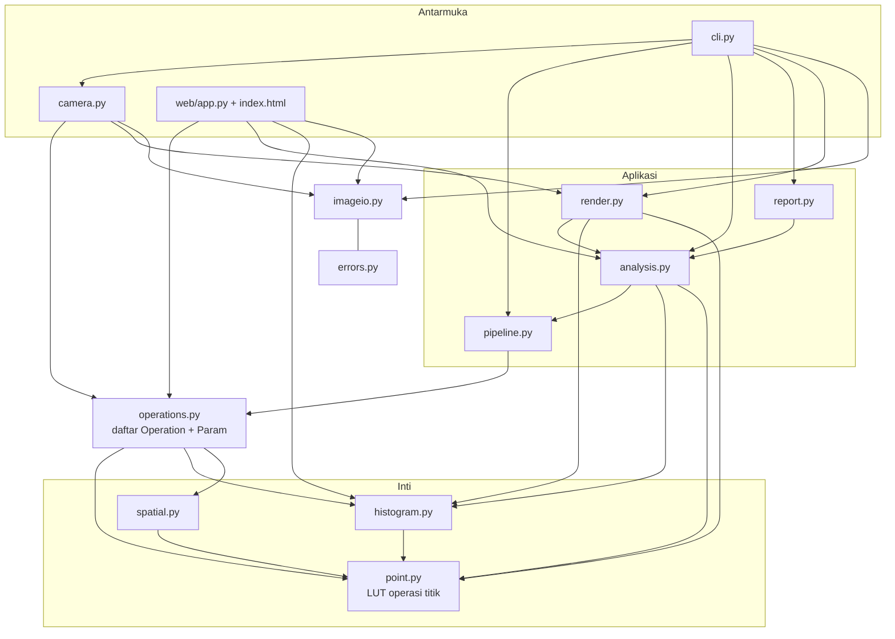

# Arsitektur

`imgenhance` dipisah menjadi lapisan yang hanya bergantung ke bawah: fungsi murni di bawah, antarmuka
(CLI, webcam, web) di atas.



## Prinsip desain

**1. Operasi titik = tabel 256 nilai.** Setiap operasi titik berupa fungsi `xxx_lut(...) -> ndarray(256,)`.
`point.apply_lut` menerapkannya dengan `cv2.LUT` (opsional hanya pada kanal Y). Konsekuensinya:
mudah diuji (cukup memeriksa tabel, tanpa gambar), cepat, dan kurva `s = T(r)` tersedia gratis dari
tabel yang sama.

**2. Satu daftar operasi untuk semua antarmuka.** `operations.py` mendefinisikan tiap operasi sebagai
data: nama, judul, rumus, rujukan slide, dan daftar `Param` (tipe `int` / `float` / `choice` / `bool`,
rentang, nilai bawaan, bantuan, dan syarat tampil `when`). Dari daftar yang sama dibangun:

| Pengguna daftar | Yang dihasilkan |
|---|---|
| `cli.py` | sub-parser `apply <operasi>` beserta opsi dan bantuannya |
| `web/app.py` + `index.html` | `GET /api/operations` lalu slider / dropdown dibuat di browser |
| `camera.py` | parameter utama yang bisa diubah dengan `+` / `-` |
| `Operation.resolve` | validasi: nilai di luar rentang atau kunci tak dikenal menjadi `ParameterError` |

Menambah operasi baru cukup menulis fungsi LUT dan satu entri `Operation` di `OPERATIONS`; CLI, demo
web, dan webcam langsung mengenalinya.

**3. Hasil operasi adalah objek.** `apply_operation` mengembalikan `EnhanceResult(image, lut, note)`.
`lut` bernilai `None` untuk operasi aras lokal (smoothing, median, sharpening) yang tidak punya kurva
`T(r)`; `note` membawa informasi hasil perhitungan (mis. `r1=100, r2=143` pada stretching persentil
atau `T` hasil Otsu).

**4. Pipeline divalidasi di awal.** `Pipeline.parse(["grayscale", "gamma:gamma=0.6", "equalize"])`
memeriksa nama dan parameter semua langkah **sebelum** gambar disentuh. `PipelineResult.stages` menyimpan
hasil tiap langkah; `PipelineResult.lut` (kurva `T(r)`) hanya diisi bila rangkaian terdiri dari satu
langkah berbasis LUT. Untuk rangkaian panjang, bandingkan histogram sebelum / sesudah.

**5. Diagnosis terpisah dari tindakan.** `analysis.diagnose` hanya membaca statistik dan mengembalikan
`Diagnosis` berisi saran berupa `Step`. Siapa yang menerapkan saran itu (`auto`, tombol "Terapkan saran"
di web) adalah urusan lapisan atas.

**6. Rendering hanya dengan OpenCV.** `render.py` menggambar panel (gambar, statistik, histogram, kurva)
tanpa matplotlib, supaya instalasi cukup `numpy` + `opencv-python`. Teks dipaksa ASCII lewat `_safe`
karena font Hershey bawaan OpenCV tidak mendukung karakter lain.

**7. Aman terhadap lingkungan.** Gambar dibaca lewat `np.frombuffer` + `cv2.imdecode` (path Unicode
Windows aman), ditulis lewat `cv2.imencode` (kegagalan menjadi `ImageWriteError`), dan semua pemanggilan
jendela GUI (`imshow`, `destroyAllWindows`) mentoleransi OpenCV build *headless*.

## Penanganan galat dan kode keluar

```
EnhanceError
├── ImageLoadError      file tidak ada / rusak
├── ImageWriteError     gagal menyimpan (ekstensi tak dikenal, folder tak bisa ditulis)
├── OperationError      operasi tidak bisa dijalankan pada gambar ini
├── ParameterError      parameter di luar rentang / tidak dikenal   (juga ValueError)
└── CameraError         kamera tidak bisa dibuka / frame gagal dibaca
```

| Kode keluar | Arti |
|---|---|
| `0` | sukses |
| `1` | galat operasional (`EnhanceError`, mis. file tidak ditemukan) |
| `2` | salah penggunaan: argumen tidak valid atau parameter di luar rentang |
| `130` | dihentikan pengguna (Ctrl+C) |

CLI menangkap `EnhanceError` di satu tempat (`main`) dan mencetak `ERROR   <pesan>` ke stderr tanpa
*traceback*; `-v` menaikkan log ke DEBUG.

## Demo web

`web/app.py` (`create_app`) menyediakan:

| Endpoint | Fungsi |
|---|---|
| `GET /` | halaman satu file (`index.html`, tanpa build step) |
| `GET /api/health` | status dan versi |
| `GET /api/operations` | daftar operasi + parameter (dasar pembentukan kontrol di UI) |
| `POST /api/enhance` | unggah gambar + operasi + parameter; jawaban berisi gambar hasil (PNG data URL), statistik, histogram sebelum / sesudah, kurva `T(r)`, dan diagnosis + saran |
| `GET /api/docs` | dokumentasi OpenAPI interaktif |

Batas pengaman dan kode respons: unggahan maksimum 8 MB (`413`); tipe konten harus JPG / PNG / WebP /
BMP (`415`); isi berkas didekode sehingga file palsu atau rusak ditolak; `max_side` (bawaan 1280,
maksimum 4096, `0` = ukuran asli) memperkecil gambar sebelum diproses; setiap `EnhanceError`
(parameter di luar rentang, gambar tidak valid, ...) menjadi `422` berisi pesan Indonesia.
`uvicorn` mengikat `127.0.0.1` secara bawaan.

## Pengujian

| Berkas uji | Yang diperiksa |
|---|---|
| `test_point.py`, `test_histogram.py` | LUT (nilai tepat, monotonik, batas 0 / 255), contoh soal materi, gambar seragam |
| `test_operations.py`, `test_pipeline.py` | registri, validasi parameter, parsing langkah pipeline |
| `test_analysis.py` | ambang gelap / terang / kontras rendah dan saran |
| `test_render.py`, `test_report.py` | ukuran panel, teks ASCII-aman, JSON dan CSV (BOM) |
| `test_imageio.py` | path Unicode, file rusak, ekstensi tak dikenal, gambar abu-abu 3 kanal |
| `test_cli.py`, `test_camera.py`, `test_web.py` | kode keluar, keluaran, webcam palsu, API, OpenCV tanpa GUI |
| `test_examples.py` | `soal_materi.py`, `usage.py`, dan `generate_samples.py` tetap berjalan |

`make check` menjalankan ruff (lint + format), mypy `strict`, dan pytest. CI mengulanginya pada
Python 3.9-3.12 dan membangun paket (sdist + wheel).
